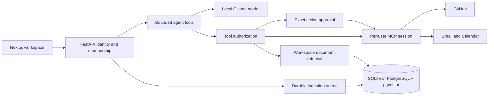

# SentinelAI 2.0

A private engineering workspace for **evidence-backed investigation and approved
actions**. Run a local model, search documents within a workspace, inspect sources,
and approve exact changes to connected tools.

[](https://github.com/virinchisai/sentinel-ai/actions/workflows/test.yml)
[](https://github.com/virinchisai/sentinel-ai/actions/workflows/codeql.yml)

## What works in v2

- Ollama local inference with streamed text and tool execution events; optional
  OpenAI/Anthropic adapters remain available.
- Persistent conversations with complete tool-call metadata, saved-session UI,
  cancellation, and optional validated planning.
- Personal/team workspaces, membership checks, owner-controlled document changes,
  and scoped retrieval. A viewer cannot execute host or external connector tools.
- Safe, bounded document uploads; durable ingestion jobs; previews; replacements
  with source hashes/version counters; deletion including indexed chunks.
- Local keyword search or hybrid search with Ollama embeddings. PostgreSQL uses
  full-text search, pgvector HNSW candidates, and rank fusion; SQLite supports a
  lightweight local deployment.
- Exact, expiring, single-use approvals for issue creation, comments, email drafts,
  and calendar events. Writes are never automatically retried.
- Encrypted per-user GitHub/Google credentials, real Gmail/Calendar API calls,
  refresh-token rotation, durable logout revocation, and optional Keycloak SSO.
- Prometheus metrics, tool/approval audit records, optional self-hosted Langfuse
  tracing, regression tests, retrieval benchmarks, and repaired container builds.

This is a **single-worker small-team pilot**, not a certified enterprise service.
See [operational boundaries](docs/operations.md) before using sensitive data.

## Run locally

Requires Python 3.11/3.12, Node 22.13+, and Ollama. The software can run without
paid inference APIs; hardware, electricity, hosting, and provider account rules
still apply.

```bash
git clone https://github.com/virinchisai/sentinel-ai.git
cd sentinel-ai
git checkout v2.0.0
python3.12 -m venv .venv
source .venv/bin/activate
pip install -r requirements.lock
pip install --no-deps -e .
python scripts/configure.py
ollama pull qwen2.5:1.5b
python -m backend.migrate
uvicorn backend.api.main:app --host 127.0.0.1 --port 8000
```

Start Ollama separately if it is not running. In another terminal:

```bash
cd frontend
npm ci
npm run dev
```

Open **http://localhost:3000**, register your account, and upload documents.
There is no shared demo password. To ingest the included sample policies into your
account, look up your ID from `/auth/me`, then run:

```bash
python -m backend.rag.ingest --user-id YOUR_USER_ID
```

Optional hybrid retrieval:

```bash
ollama pull nomic-embed-text
# Set EMBEDDING_MODEL=nomic-embed-text in .env, restart, then upload/reindex documents.
```

Use `OLLAMA_MODEL` to select a model suited to your hardware. Smaller models use
less memory, but evaluate tool selection and answer quality before relying on them.

## Docker Compose

```bash
python scripts/configure.py  # only if .env does not exist
# Run Ollama on an address reachable from Docker; see docs/operations.md.
docker compose --env-file .env -f docker/docker-compose.yml up --build -d
```

This starts PostgreSQL/pgvector, the API, and Next.js. Published ports bind to
loopback. Configure a TLS reverse proxy and trusted origins for shared access.

## Verify

```bash
pip install -e '.[dev]'
pytest backend/tests -q
PYTHONPATH=. python scripts/benchmark.py
cd frontend
npm run lint
npm run build
```

With both local servers running, `bash scripts/browser-smoke.sh` verifies
registration, upload, preview, streaming UI, deletion, and logout using the
Playwright CLI. Streaming UI is mocked; the separate live-agent smoke test
verifies real local inference and retrieval.

The sample retrieval benchmark is a deterministic release gate, not a claim of
production answer accuracy. Live local checks are available in
`scripts/local_smoke.py` and `scripts/live_agent_smoke.py`; run them from the repo
root with `PYTHONPATH=.` and a configured Ollama model.

## Architecture



- [Upgrade, backups, deployment, optional tools](docs/operations.md)
- [Connector setup and permissions](docs/connectors.md)
- [Security model](SECURITY.md)
- [Version 2.0 changes](CHANGELOG.md)

## License

MIT for SentinelAI. Dependencies and model weights retain their own licenses.
