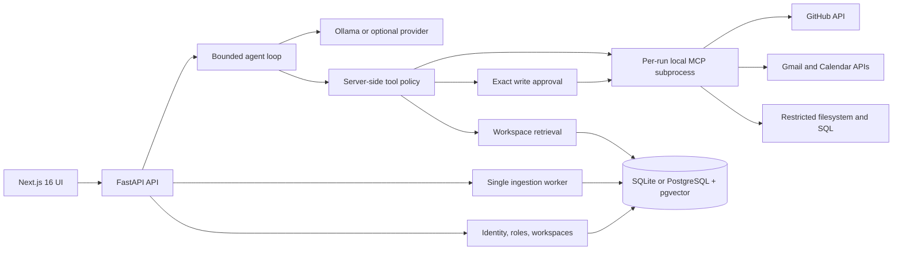

# SentinelAI v2.0

SentinelAI is a local-first, self-hostable AI workspace for evidence-backed
investigation and explicitly approved actions. It combines workspace-scoped
document retrieval, a bounded tool-using agent, and GitHub, Gmail, Calendar,
filesystem, and SQL connectors behind a FastAPI API and Next.js interface.

[](https://github.com/virinchisai/sentinel-ai/actions/workflows/test.yml)
[](https://github.com/virinchisai/sentinel-ai/actions/workflows/codeql.yml)
[](https://github.com/virinchisai/sentinel-ai/actions/workflows/knowledge-reliability.yml)
[](https://github.com/virinchisai/sentinel-ai/releases/tag/v2.0.0)
[](LICENSE)

> **Deployment status:** v2.0 is a single-worker, small-team pilot—not a
> high-availability service or a certified enterprise security product. Review
> [the operating boundaries](docs/operations.md) before using sensitive data.

## What v2.0 provides

- Local Ollama inference with streaming responses; optional OpenAI and Anthropic
  adapters are also available.
- Persistent conversations with complete tool-call history, source previews,
  cancellation, and optional planning.
- Personal and team workspaces with membership checks, owner-controlled document
  lifecycle, and workspace-scoped retrieval.
- Bounded `.txt`, `.md`, and `.pdf` uploads, durable queued ingestion, previews,
  replacement with source hashes/version counters, and indexed deletion.
- Keyword retrieval with SQLite, or hybrid full-text and pgvector retrieval with
  PostgreSQL and Ollama embeddings.
- Exact, expiring, single-use approval records for GitHub writes, Gmail drafts,
  and Calendar event creation. Write calls are not automatically retried.
- Per-user encrypted GitHub and Google credentials, optional PKCE Keycloak login,
  Prometheus metrics, audit records, and optional self-hosted Langfuse timing.
- Python 3.11/3.12 CI, frontend lint/build checks, PostgreSQL and browser smoke
  tests, container builds, CodeQL, and deterministic retrieval release gates.

SentinelAI exposes 18 tools from one local MCP server across seven families:

| Family | Tools | Access boundary |
|---|---|---|
| Knowledge | `query_knowledge_base` | Workspace-scoped |
| GitHub | Search issues/code; create issues; comment | Personal credential, repository allowlist; writes need approval |
| Gmail | Search; get thread; create draft reply | Personal Google credential; drafts need approval |
| Calendar | List events; check availability; create event | Personal Google credential; creates need approval |
| Filesystem | List; read; search | Administrator only; restricted root |
| Database | Read-only query; describe schema | Administrator only; dedicated database account recommended |
| System | Echo; current time | Authenticated chat access |

## Architecture



The API creates a trusted actor from the authenticated user and selected workspace.
The model does not choose user identity or bypass policy. Membership and role checks
run before schema exposure, tool execution, and approved write execution. Documents
and tool output are treated as untrusted evidence rather than authorization input.

See [architecture](docs/architecture.md), [security](SECURITY.md), and
[connector setup](docs/connectors.md) for details.

## Local quick start

Prerequisites: Python 3.11 or 3.12, Node.js 22, and
[Ollama](https://ollama.com/). No paid inference API is required for the default
configuration.

```bash
git clone https://github.com/virinchisai/sentinel-ai.git
cd sentinel-ai
git checkout v2.0.0

python3.12 -m venv .venv
source .venv/bin/activate
pip install -r requirements.lock
pip install --no-deps -e .
python scripts/configure.py

ollama pull qwen2.5:1.5b
python -m backend.migrate
uvicorn backend.api.main:app --host 127.0.0.1 --port 8000
```

Start Ollama separately if it is not already running. In another terminal:

```bash
cd frontend
npm ci
npm run dev
```

Open <http://localhost:3000>, register an account, create or select a workspace,
and upload documents. There is no shared demo password.

Keyword search works without an embedding model. For hybrid retrieval, pull the
embedding model, set `EMBEDDING_MODEL=nomic-embed-text` before ingestion, restart,
and upload or reindex documents:

```bash
ollama pull nomic-embed-text
```

Use `OLLAMA_MODEL` to choose a tool-capable model suitable for your hardware.
Evaluate tool selection and answer quality for your own data before relying on it.

## Docker Compose

```bash
python scripts/configure.py  # only when .env does not already exist
docker compose --env-file .env -f docker/docker-compose.yml up --build -d
```

Compose starts PostgreSQL with pgvector, the API, and the Next.js frontend. Ollama
runs on the host and must be reachable from the API container. Published ports bind
to loopback by default. A shared deployment needs TLS, trusted origins, protected
`/metrics` access, backups, and suitable host/network controls.

The release also publishes Linux AMD64 images:

```bash
docker pull ghcr.io/virinchisai/sentinel-ai-backend:v2.0.0
docker pull ghcr.io/virinchisai/sentinel-ai-frontend:v2.0.0
```

Build the frontend yourself with `NEXT_PUBLIC_API_URL` when the API is not available
at `http://localhost:8000`. ARM hosts require emulation or a native local build.

## Configuration

Run `python scripts/configure.py` to create `.env` safely. Important settings are:

| Setting | Purpose |
|---|---|
| `LLM_PROVIDER` | `ollama` by default; optional provider adapters are supported |
| `OLLAMA_BASE_URL`, `OLLAMA_MODEL` | Local inference endpoint and model |
| `EMBEDDING_MODEL` | Empty for keyword-only; `nomic-embed-text` for hybrid retrieval |
| `DATABASE_URL` | SQLite locally or PostgreSQL for pgvector/full-text retrieval |
| `JWT_SECRET_KEY` | Deployment secret; production rejects known weak defaults |
| `ALLOWED_ORIGINS` | Exact browser origins allowed by CORS |
| `GITHUB_ALLOWED_REPOS` | Additional allowlist for GitHub tools |
| `TOOL_DATABASE_URL` | Separate restricted database account for the SQL tool |
| `WORKSPACE_DIR` | Filesystem-tool root |
| `DOCUMENT_PARSER` | `basic`, or optional `docling` after installing its extra |
| `ENABLE_LANGFUSE` | Enables optional timing-only traces when configured |

GitHub and Google credentials are configured per user in Settings. Use narrowly
scoped provider credentials and follow [the connector guide](docs/connectors.md).

## Verification

```bash
pip install -e '.[dev]'
pytest backend/tests -q
PYTHONPATH=. python scripts/benchmark.py

cd frontend
npm run lint
npm run build
```

The v2.0 release validation recorded 41 passing backend tests, frontend lint and
build success, PostgreSQL/pgvector checks, container builds, a browser workflow,
and a 6/6 sample-document retrieval gate. These are release checks—not production
accuracy, load, or security certification. See the full
[release validation record](docs/release-validation.md).

## Security and operating limits

The main safeguards are server-side membership/RBAC enforcement, repository and
host-tool restrictions, bounded uploads and SQL results, refresh-token rotation and
logout revocation, connector credential encryption at rest, and durable exact write
approvals. Production startup requires a strong deployment secret.

Current limits include:

- one API process and one ingestion worker; no multi-replica coordination or HA;
- application-layer workspace isolation, without PostgreSQL row-level security;
- browser bearer tokens stored in `localStorage`;
- mutable application audit records rather than an external immutable ledger;
- no exactly-once guarantee across an external write and a process crash;
- model-dependent citation and tool-selection quality;
- optional Keycloak, Docling, and Langfuse services are not bundled by Compose.

Read [SECURITY.md](SECURITY.md) and [operations](docs/operations.md) before a shared
deployment. Report vulnerabilities through GitHub's private security reporting
interface rather than a public issue.

## Repository guide

```text
backend/api/             FastAPI routes and lifecycle
backend/auth/            Local/OIDC auth, roles, workspaces, audit data
backend/agents/          Provider adapters, orchestration, policy, MCP client
backend/rag/             Parsing, chunking, storage, retrieval, ingestion jobs
backend/mcp_server/      One FastMCP server and connector implementations
frontend/                Next.js 16 / React 19 interface
evaluation/              Deterministic retrieval evaluation data
knowledge/               Provenance-pinned sample knowledge claims
knowledge-tests/         Knowledge-policy expectations
docker/                  Backend/frontend images and Compose stack
docs/                    Architecture, connectors, operations, validation
```

## License

SentinelAI is available under the [MIT License](LICENSE). Dependencies and model
weights retain their own licenses.

Built by [Virinchi Sai Athmakuri](https://github.com/virinchisai).
