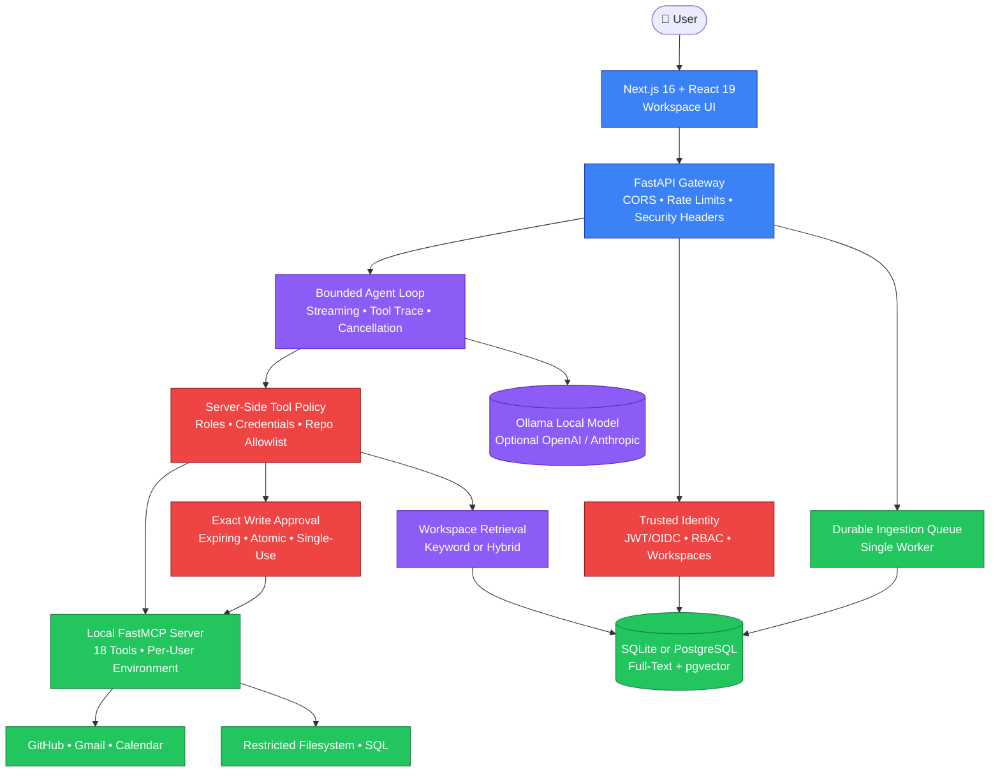

<div align="center">

# 🛡️ SentinelAI

### Secure, Local-First AI Workspace

*A self-hostable AI agent that connects teams to workspace knowledge, source code,
email, calendars, and operational tools through the **Model Context Protocol (MCP)**.*

<br>

[](https://github.com/virinchisai/sentinel-ai/actions/workflows/test.yml)
[](https://github.com/virinchisai/sentinel-ai/actions/workflows/codeql.yml)
[](https://github.com/virinchisai/sentinel-ai/actions/workflows/knowledge-reliability.yml)
[](https://github.com/virinchisai/sentinel-ai/releases/tag/v2.0.0)


[**Download v2.0.0**](https://github.com/virinchisai/sentinel-ai/releases/tag/v2.0.0) ·
[**Architecture**](#architecture) ·
[**Features**](#features) ·
[**Quick Start**](#quick-start) ·
[**Security**](#security) ·
[**Operations**](docs/operations.md)

</div>

---

> [!IMPORTANT]
> SentinelAI v2.0 is a **single-worker, small-team pilot**. It is not a
> high-availability service or a certified enterprise security product. Review the
> [operating boundaries](docs/operations.md) before using sensitive data.

## 💡 What is SentinelAI?

Imagine asking one workspace:

> *“What does our incident policy require, did anyone discuss this in Gmail, and is
> there already a GitHub issue?”*

SentinelAI can search only the documents available to that workspace, inspect
connected services using that user's credentials, show its sources and tool trace,
and pause before an external write. The user reviews the exact action and arguments;
nothing pending approval is executed.

It is more than a chat wrapper: it demonstrates the platform controls around an AI
agent—**identity, authorization, workspace isolation, retrieval, tool policy,
approvals, audit records, evaluation, and deployment**.

### Why MCP?

The [Model Context Protocol](https://modelcontextprotocol.io/) gives the agent a
standard interface for discovering and calling tools. SentinelAI exposes 18 tools
through one local FastMCP server while keeping user identity and authorization in the
trusted API layer.

---

<a id="architecture"></a>
## 🏗️ Architecture



The API establishes identity and workspace membership before the model sees any
tools. The model cannot choose another user or bypass authorization. Membership and
role checks run before tool schema exposure, execution, and approved write
execution. Documents and tool output are untrusted evidence, not instructions or
authorization.

See [architecture](docs/architecture.md), [security](SECURITY.md), and
[connector setup](docs/connectors.md) for details.

---

<a id="features"></a>
## ✨ Features

<details open>
<summary><b>🤖 Core AI and Retrieval</b></summary>

- Streamed local inference with Ollama; optional OpenAI and Anthropic adapters
- Persistent conversations with complete tool-call history and saved sessions
- Optional planning, cancellation, bounded tool iterations, and visible tool traces
- Workspace-scoped `.txt`, `.md`, and `.pdf` knowledge
- SQLite keyword retrieval for a lightweight local setup
- PostgreSQL full-text + pgvector candidates with reciprocal-rank fusion
- Source names/pages returned with retrieved evidence
- Durable queued ingestion, previews, replacement hashes/version counters, and
  deletion of indexed chunks

</details>

<details>
<summary><b>🔌 MCP Connectors — 18 tools across 7 families</b></summary>

| Connector | Tools | Boundary |
|---|---|---|
| **GitHub** | Search issues/code, create issue, comment | Personal token + repository allowlist; writes need approval |
| **Gmail** | Search, get thread, draft reply | Personal Google credential; drafts need approval |
| **Calendar** | List events, create event, check availability | Personal Google credential; creates need approval |
| **File System** | List, read, search | Administrator-only; restricted root |
| **Database** | Read-only query, describe schema | Administrator-only; dedicated account recommended |
| **Knowledge Base** | Workspace retrieval | Server-selected workspace |
| **System** | Echo, current time | Authenticated chat access |

Google reply actions create drafts; SentinelAI does not send email. Calendar event
creation may notify attendees and therefore requires exact approval.

</details>

<details>
<summary><b>🛡️ Security Controls</b></summary>

- Local bcrypt authentication with access/refresh JWTs and durable logout revocation
- Optional Keycloak OIDC using authorization code flow and S256 PKCE
- Roles for administrator, user, and viewer plus personal/team workspace membership
- Per-user encrypted GitHub and Google credentials
- Exact, expiring, atomic, single-use approval records for external writes
- No automatic retry for destructive/write tools
- Bounded upload size and filename/type checks
- Resolved-path containment for filesystem tools
- Parsed single-`SELECT`, read-only SQL with timeout and row limits
- HTTP security headers, CORS configuration, and IP-based rate limits
- CodeQL, Dependabot, locked backend dependencies, and security regressions in CI

For limitations and deployment requirements, read [SECURITY.md](SECURITY.md) and the
[production gap analysis](docs/PRODUCTION_GAP_ANALYSIS.md).

</details>

<details>
<summary><b>📊 Observability, Evaluation, and Delivery</b></summary>

- Structured JSON logging and request IDs
- Prometheus HTTP/tool metrics and LLM request counts at `/metrics`
- Tool and approval audit records
- Optional self-hosted Langfuse timing traces without document text or credentials
- 41 backend regression tests on Python 3.11 and 3.12
- Frontend lint, TypeScript, and Next.js production-build checks
- PostgreSQL/pgvector, browser-workflow, and container-build CI jobs
- Deterministic sample retrieval benchmark and knowledge-reliability checks
- Docker images plus a Compose stack for PostgreSQL/pgvector, API, and frontend

The six-case retrieval benchmark is a regression gate, not a production accuracy
claim. See the [v2.0 validation record](docs/release-validation.md).

</details>

---

<a id="quick-start"></a>
## 🚀 Quick Start

### Prerequisites

- Python 3.11 or 3.12
- Node.js 22.13+
- [Ollama](https://ollama.com/)

The default path uses local inference and does not require a paid model API.

### 1. Clone and install

```bash
git clone https://github.com/virinchisai/sentinel-ai.git
cd sentinel-ai
git checkout v2.0.0

python3.12 -m venv .venv
source .venv/bin/activate
pip install -r requirements.lock
pip install --no-deps -e .

cd frontend
npm ci
cd ..
```

### 2. Configure local inference

```bash
python scripts/configure.py
ollama pull qwen2.5:1.5b
```

`scripts/configure.py` safely creates `.env`. There is no shared demo account or
password.

### 3. Start the API

```bash
python -m backend.migrate
uvicorn backend.api.main:app --host 127.0.0.1 --port 8000
```

Start Ollama separately if it is not already running.

### 4. Start the frontend

```bash
cd frontend
npm run dev
```

Open **<http://localhost:3000>**, register an account, choose a workspace, and upload
documents.

### Optional hybrid retrieval

```bash
ollama pull nomic-embed-text
```

Set `EMBEDDING_MODEL=nomic-embed-text` before ingestion, restart, and upload or
reindex documents. Use `OLLAMA_MODEL` to choose a tool-capable model suited to your
hardware, then evaluate it with your own data and workflows.

---

## 🐳 Docker Compose

```bash
python scripts/configure.py  # only when .env does not exist
docker compose --env-file .env -f docker/docker-compose.yml up --build -d
```

Compose starts **PostgreSQL/pgvector, FastAPI, and Next.js**. Ollama runs on the host
and must be reachable from the API container. Ports bind to loopback by default. For
shared access, configure TLS, trusted origins, backups, and private `/metrics` and
MCP access.

Published Linux AMD64 images are also available:

```bash
docker pull ghcr.io/virinchisai/sentinel-ai-backend:v2.0.0
docker pull ghcr.io/virinchisai/sentinel-ai-frontend:v2.0.0
```

Build the frontend with `NEXT_PUBLIC_API_URL` when the API is not at
`http://localhost:8000`. ARM hosts require emulation or a native build.

---

## ⚙️ Configuration

| Setting | Purpose |
|---|---|
| `LLM_PROVIDER` | `ollama` by default; optional provider adapters supported |
| `OLLAMA_BASE_URL`, `OLLAMA_MODEL` | Local inference endpoint and model |
| `EMBEDDING_MODEL` | Empty for keyword-only; `nomic-embed-text` for hybrid search |
| `DATABASE_URL` | SQLite locally or PostgreSQL for full-text/pgvector retrieval |
| `JWT_SECRET_KEY` | Deployment secret; weak defaults are rejected in production |
| `ALLOWED_ORIGINS` | Exact browser origins allowed by CORS |
| `GITHUB_ALLOWED_REPOS` | Additional allowlist for GitHub tools |
| `TOOL_DATABASE_URL` | Separate restricted account for the SQL tool |
| `WORKSPACE_DIR` | Filesystem-tool root |
| `DOCUMENT_PARSER` | `basic`, or optional `docling` after installing its extra |
| `ENABLE_LANGFUSE` | Enables optional timing traces when fully configured |

GitHub and Google credentials are added per user in Settings. Use narrowly scoped
provider credentials and follow the [connector guide](docs/connectors.md).

---

## 🧪 Testing

```bash
pip install -e '.[dev]'
pytest backend/tests -q
PYTHONPATH=. python scripts/benchmark.py

cd frontend
npm run lint
npm run build
```

The v2.0 release recorded:

- **41/41 backend tests passed**
- **6/6 expected retrieval sources found within the top 3**
- frontend lint and production build passed
- PostgreSQL/pgvector isolation and migration checks passed
- API/frontend container builds passed
- registration, login, upload, preview, streaming UI, deletion, and logout passed

Google/OIDC calls and browser streaming are deterministic mocks in CI. A separate
local-agent smoke test exercises real Ollama inference and retrieval. No real email,
calendar invitation, or GitHub write is sent during the release checks.

See [release validation](docs/release-validation.md) for exact scope and limitations.

---

## 🗂️ Repository Tour

```text
sentinel-ai/
├── backend/
│   ├── api/             # FastAPI routes and lifecycle
│   ├── auth/            # Local/OIDC auth, roles, workspaces, audit data
│   ├── agents/          # Providers, orchestration, policy, MCP client
│   ├── rag/             # Parsing, chunking, retrieval, ingestion jobs
│   ├── mcp_server/      # FastMCP server and connector implementations
│   ├── observability/   # Logging, metrics, request tracing
│   └── tests/           # Security and regression tests
├── frontend/            # Next.js 16 / React 19 workspace UI
├── evaluation/          # Deterministic retrieval evaluation data
├── knowledge/           # Provenance-pinned sample knowledge claims
├── knowledge-tests/     # Knowledge-policy expectations
├── docker/              # Backend/frontend images and Compose stack
├── docs/                # Architecture, connectors, operations, validation
├── .github/workflows/   # CI, CodeQL, packaging, knowledge reliability
├── SECURITY.md          # Trust boundaries and vulnerability reporting
└── CHANGELOG.md         # Version history and upgrade notes
```

---

<a id="security"></a>
## 🛡️ Security

SentinelAI uses server-side controls rather than model instructions as its security
boundary.

| Threat | Current mitigation |
|---|---|
| Cross-workspace access | Trusted actor context + membership checks on data paths |
| Prompt injection into writes | Server-side authorization + exact user approval |
| Accidental duplicate writes | No automatic write retries; atomic approval consumption |
| Over-scoped GitHub action | Per-user token + configured repository allowlist |
| SQL mutation/unbounded query | Parsed single `SELECT` + read-only session + limits |
| Filesystem path traversal | Resolved-path containment under configured root |
| Stolen/replayed refresh token | One-time refresh rotation + durable session version |
| Vulnerable changes | Regression tests, CodeQL, Dependabot, locked dependencies |

### Known boundaries

- Single API process and ingestion worker; no multi-replica coordination or HA
- Application-layer workspace isolation without PostgreSQL row-level security
- Browser bearer tokens stored in `localStorage`
- Mutable application audit records rather than an immutable external ledger
- No exactly-once guarantee across an external write and process crash
- Model-dependent citation and tool-selection quality
- Keycloak, Docling, and Langfuse are optional and not bundled by Compose

Read the [production gap analysis](docs/PRODUCTION_GAP_ANALYSIS.md) for the prioritized
hardening roadmap. Report vulnerabilities through GitHub's private security
reporting interface—not a public issue.

---

## 💼 Why this project matters

SentinelAI demonstrates the work around an AI model that makes an agent useful and
controllable: authentication, workspace-scoped retrieval, MCP integration,
least-privilege tools, durable approvals, connector credential handling,
observability, evaluation, and reproducible delivery.

<details>
<summary><b>📋 Accurate resume bullet</b></summary>

> Built SentinelAI v2.0, a local-first MCP agent workspace integrating GitHub,
> Gmail, Calendar, read-only SQL, restricted filesystem tools, and workspace-scoped
> retrieval. Implemented FastAPI authentication/RBAC, per-user encrypted connector
> credentials, exact single-use write approvals, PostgreSQL full-text + pgvector
> search, a Next.js 16 interface, 41 backend regressions, retrieval release gates,
> CodeQL, and tested Docker delivery for a single-worker small-team pilot.

</details>

## 📈 Star History

[](https://star-history.com/#virinchisai/sentinel-ai&Date)

## 📜 License

MIT — see [LICENSE](LICENSE). Dependencies and model weights retain their own
licenses.

---

<div align="center">

**Built by [Virinchi Sai Athmakuri](https://github.com/virinchisai)** ·
[LinkedIn](https://www.linkedin.com/in/virinchisaiathmakuri/) ·
[Email](mailto:saivirinchi103@gmail.com)

⭐ Star this repo if you find it useful!

</div>
